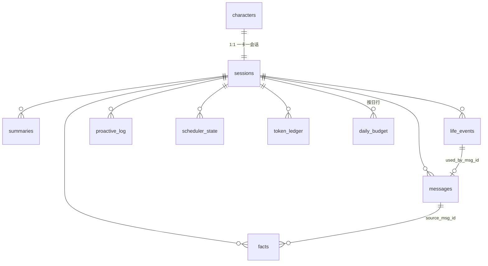

# 项目架构（V1.0）

> 状态：**已定稿，等待 M0 落地**。本文是实现的唯一形状来源；`AGENTS.md` 管怎么干活，`Rule.md` 管什么不许干，`Workflow.md` 管从 spec 到验收的流程，`.scratch/proactive-companion-runtime/spec.md` 管具体行为。
>
> 冲突优先级：`Rule.md` > 本文 > spec > PRD > `prototype/`。本文与 spec 冲突时以本文为准，并在 `docs/adr/` 留下一张票说明为什么。

---

## 1. 系统一句话与硬边界

一个 Node 常驻进程，同时是**唯一 HTTP 服务**、**唯一调度宿主**、**唯一 SQLite 写入者**。页面是纯消费者：打开看得见，关掉进程照常过日子。

```
┌──────────────────────────────────────────────────────────┐
│ 进程（node src/index.js，单实例，127.0.0.1 本地）           │
│                                                          │
│  runtime ──┬─> http ──> (SSE / JSON) ──> 浏览器 SPA        │
│            ├─> schedule ──> proactive                     │
│            ├─> living                                    │
│            └─> bus（进程内事件，单向广播）                   │
│                                                          │
│  业务模块 ──> llm（单一 OpenAI 兼容端点）                    │
│           └─> store（SQLite，WAL，唯一写入者）              │
│           └─> clock（唯一时间源）                          │
└──────────────────────────────────────────────────────────┘
```

四条不可谈判的边界：

1. **页面永不写库、永不承担定时。** 浏览器刷新/关闭/崩溃不影响任何调度状态。
2. **只有 `store` 碰 SQL。** 其他模块通过 repo 函数读写，拿不到 `db` 句柄。
3. **只有 `clock` 回答"现在几点、跨日没有"。** 业务模块禁止直接 `Date.now()` / `new Date()`。
4. **只有 `http` 说人话给界面。** 业务模块抛 `AppError(code)`，中文文案与 HTTP 状态码在 `http` 层映射。

---

## 2. 架构决策索引

已封板的业务决策在 spec 里（D-0…D-15、PRD 4.4）。本文只记录**落地形状**上的决策，逐条对应 ADR：

| # | 决策 | ADR |
|---|---|---|
| A1 | 单进程单入口，页面纯消费者，单写入者 | 0001 |
| A2 | 零运行时第三方依赖；`node:sqlite` 取代 `better-sqlite3`；纯 JS + JSDoc，无构建 | 0002 |
| A3 | 时钟与 `runTick` 各只有一个注入点 | 0003 |
| A4 | HTTP/SSE 是唯一测试缝；测试栈 = `node:test` + `fetch` + 假 LLM 进程 | 0004 |
| A5 | 卡片无损往返 = 原始字节往返（存原文、复用原图） | 0005 |
| A6 | 无 Electron；托盘与自启走 PowerShell 辅助进程 | 0006 |

不在 ADR 里重复、但同样不可改的封板项：记忆不向量化（spec D-8）、账本单调续额（D-11）、单供应商不回退（D-5）、主动消息上下文 ≤2000 且 ≤ 对话 1/3（D-6）、风格不可配置化（D-7）。

---

## 3. 目录骨架

```
/（仓库根 = 工作目录）
├── AGENTS.md                  代理入口：地图、命令、读文件顺序、硬规则
├── Rule.md                    项目约束：边界、技术栈、规范、禁止项、人类同意清单
├── Workflow.md                Spec → 拆票 → 改码 → 测试 → 验收 → 关票
├── GLOSSARY.md                领域词汇唯一来源
├── docs/
│   ├── ARCHITECTURE.md        本文
│   ├── ai-companion-spec.md   上游封板决策（只读）
│   ├── agents/                代理约定：domain.md / issue-tracker.md
│   └── adr/NNNN-*.md          架构决策记录
├── 主动陪伴AI聊天助手_PRD_V1.0.md   PRD（只读，按需 grep）
├── prototype/                 已验收原型（只读参考，不进生产）
├── src/
│   ├── index.js               唯一入口：config → runtime.start()
│   ├── runtime/               启动顺序、配置、锁、日志、事件总线、外壳
│   ├── clock/                 注入时钟 + 本地日界
│   ├── store/                 SQLite 打开/迁移/事务 + repo/*
│   ├── session/               会话生命周期与状态机（四值入库）
│   ├── cards/                 PNG/JSON 解析、导入两段、无损导出
│   ├── library/               角色库视图组装
│   ├── chat/                  对话编排、上下文组装
│   ├── style/                 人格提示词、后置过滤、系统腔黑名单
│   ├── memory/                事实抽取、20 轮摘要、关键词检索
│   ├── schedule/              runTick、剪枝、意愿、定时器宿主
│   ├── proactive/             锚点、生成、校验、预算闸门
│   ├── living/                生活事件、世界信息 pipeline
│   ├── quota/                 账本、70% 标记、耗尽判定
│   ├── llm/                   OpenAI 兼容客户端（chat 流式 / utility JSON）
│   └── http/                  服务、路由、SSE、静态资源
├── web/                       单页界面（原生 ES module，无构建）
├── test/                      s1（对外契约）/ s2（假 LLM）/ s3（假时钟）
├── tools/                     fake-llm、db-reset、smoke、check、run-companion.ps1
├── data/                      运行时生成（不入库）：companion.db、cards/、avatars/、logs/、runtime.json、config.json
├── .scratch/                  本地 tracker：<feature>/spec.md、issues/NN-*.md
└── .specify/                  speckit 模板与空 constitution（不动）
```

目录职责与禁忌：

| 路径 | 放什么 | 不许放什么 |
|---|---|---|
| `src/runtime` | 启动序列、单实例锁、配置读写、日志、`bus`、托盘/自启调用 | 业务规则（对话/主动/记忆） |
| `src/store` | 连接、PRAGMA、迁移、事务包装、repo 函数 | 业务判断、HTTP、LLM 调用 |
| `src/*`（业务） | 纯业务：入参明确、只依赖 store/llm/clock/bus | `req`/`res`、`express`、DOM、`process.env` 直读 |
| `src/http` | 路由、参数校验、状态码、中文文案、SSE 帧 | SQL、提示词、调度决策 |
| `web` | 渲染与交互 | 任何数据库/定时逻辑 |
| `test` | 三个测试缝的用例与夹具 | 复用生产内部实现做断言 |
| `tools` | 假 LLM、脚本、冒烟 | 被 `src` 反向引用 |
| `prototype` | 只读参考 | 修改（要改先问人） |

---

## 4. 模块契约（实现时照签名写）

### 4.1 依赖方向（单向，违者视为架构破坏）

```
runtime ──> http, schedule, living, store, session, bus
http    ──> 业务模块（只调用公开函数）, bus
schedule──> proactive, session, store, clock, bus
proactive─> memory, living(读), llm, quota, store, clock, bus
chat    ──> style, memory, llm, quota, session(读), store, clock, bus
session ──> store, quota, clock, bus
memory  ──> llm, store, clock
cards   ──> store, clock
library ──> store, session, quota
living  ──> llm, store, clock, 白名单抓取器
quota   ──> store, clock
llm     ──> clock（超时）, 无其他业务依赖
store   ──> clock（只用于写时间戳，由调用方传入更佳）
clock   ──> 无
bus     ──> 无
```

禁止清单（`Rule.md` 有对应条目与审核方式）：

- 业务模块 import `http/*`（反向调用）——**唯一**允许的是 `http` import 业务模块。
- 业务模块拿 `db` 句柄直接跑 SQL（绕过 repo）。
- `src/**` 里出现 `Date.now()` / `new Date()` / `setTimeout`（`clock` 与 `schedule` 除外）。
- `llm` 里出现供应商分支、多端点、自动回退。
- `web` 里出现任何写库或 tick 逻辑。

### 4.2 `clock`

```js
// src/clock/index.js
createClock({ now: () => number })      // 注入点：唯一时间来源
clock.now()                             // epoch ms
clock.iso()                             // UTC ISO8601 字符串（入库唯一格式）
clock.localDay(ms?)                      // 'YYYY-MM-DD'（本地日界，仅此一处换算）
clock.localTimeMinutes(ms?)              // 当日本地分钟数（08:30 → 510）
clock.untilNext(hhmm)                    // 距下一次本地 hh:mm 的毫秒
clock.setTimer(fn, ms) / clearTimer(id)  // 生产=setTimeout；测试=可控堆
```

生产实现 `systemClock`；测试实现 `fakeClock.advance(ms)`。`life_events.event_date` 与 `daily_budget.date` 是唯二本地日期列，换算只发生在 `clock.localDay()`。

### 4.3 `store`

```js
// src/store/index.js
openStore({ dataDir, clock })   // 建目录、开库、PRAGMA journal_mode=WAL、foreign_keys=ON、busy_timeout=5000
store.migrate()                 // schema 版本表 + 顺序执行 migrations，事务内
store.tx(fn)                    // BEGIN IMMEDIATE / COMMIT / ROLLBACK（写事务唯一入口）
store.read(fn)                  // 只读包装（可选快照）
store.close()
```

- 迁移文件 `src/store/migrations/NNNN-*.sql`，只追加不改写；`schema_version` 存当前版本。
- 崩溃安全：WAL + 事务；启动时 `PRAGMA integrity_check`，失败则把库改名为 `companion.corrupt-<ts>.db` 并拒绝启动（保留现场）。
- repo 按表拆分，每个函数只做一件事、只碰自己那张表；跨表操作写在业务模块的 `store.tx()` 里。

repo 函数命名约定：`insert*` / `get*` / `list*` / `update*` / `delete*` / `count*` / `agg*`。返回普通对象（camelCase），不返回 Statement。

### 4.4 `session`（状态机唯一入口）

```js
// src/session/state.js
getSession(sessionId)
transition(sessionId, event, ctx)  // event: 'start'|'pause'|'resume'|'exhaust'|'refill'|'restart'|'llm_down'|'llm_up'
canGenerate(sessionId)             // state === 'active' | 'paused'（dormant 直接 false）
```

| state（入库） | 界面叙事词 | 生成对话 | 生成主动消息 |
|---|---|---|---|
| `unstarted` | 不出镜（卡上只给「开始聊天」按钮） | 否 | 否 |
| `active` | 醒着 | 是 | 是 |
| `paused` | 在忙 | 是 | 否 |
| `dormant` | 不方便 | 否（只回极短或沉默，且不出系统腔） | 否 |

迁移只能走 `transition()`；每次成功迁移写 `state_change` 事件（bus + 日志）。非法迁移（如 `dormant → paused`）丢弃并记 warn，不改库。重启是自环：状态不变，置 `cold_start_silenced = 1`。

### 4.5 `llm`

```js
// src/llm/index.js
createLlm({ config, clock, log })
llm.chatStream({ messages, maxTokens, timeoutMs })   // async iterator: {delta} / {usage} / {done}
llm.chatOnce({ messages, timeoutMs })                // { text, usage }（非流式，用于摘要等兜底）
llm.json({ system, user, schema, timeoutMs })        // 强制 JSON，schema 校验，失败抛 AppError('llm_bad_json')
```

- 端点固定 `POST {base_url}/chat/completions`，`stream: true` 时带 `stream_options: { include_usage: true }`。
- `chat`：超时 30s，可重试状态码（429/500/502/503/504）重试 2 次，退避 1s/3s；4xx 鉴权类不重试。
- `utility`：超时 10s，不重试；输入 ≤4k token；输出必须过 schema。
- 端点不可用 = 产品不可用：抛 `AppError('llm_unavailable', { retryable: false })`，上层把受影响会话转 `paused`。**没有降级通道、没有第二供应商。**

### 4.6 `bus`（进程内广播）

```js
bus.emit(topic, payload)      // message | state | quota | tick | import | log
bus.subscribe(fn) -> unsubscribe
```

只做单向广播，不带请求上下文；`http` 订阅后转成 SSE 帧。业务模块不感知 SSE 存在。

### 4.7 `schedule`（唯一调度实现）

```js
// src/schedule/index.js
runTick(sessionId, trigger)   // trigger: 'timer'|'hard'|'manual' → Decision
startScheduler({ clock, config })   // 抖动定时器宿主（生产）；测试不启动
stopScheduler()
```

```js
// Decision 形状（同时是 scheduler_state 一行 + 抽屉一条）
{ sessionId, decision: 'skip'|'send', reason: 'state_not_active'|'budget_global_full'
  |'budget_session_full'|'too_soon'|'no_anchor'|'low_willingness'|'send'|'race'|'too_long'
  |'anchor_fail'|'llm_error', willingness, trigger, at }
```

剪枝顺序、意愿公式、6 小时硬触发见 spec D-3，**逐条照抄，不许重排**。定时器只负责"到点调用 `runTick`"；所有决策都在 `runTick` 内部，测试用 `manual` 触发同一函数。单次 tick 不排队：上一轮未结束时跳过本次。

### 4.8 `proactive`

```js
buildAnchors(sessionId)        // 有序集合（事件 + pending facts），截断 5
generate(sessionId, anchors)   // { bubbles, anchor } 生成 + 校验
validate(resp, anchors)        // { ok, reason }
commit(sessionId, msg, anchor) // 事务：写 messages/proactive_log/life_events 使用标记/facts 状态/预算/账本
```

校验三条全过才提交：`anchor.id` 在集合内、`anchor.type` 与来源一致、正文命中锚点关键片段（`fact.value` 或事件正文按标点切出的 ≥2 字段落任一出现）。任一条失败：丢弃、不扣预算、写 `proactive_drop{reason}`。

### 4.9 `chat` / `style`

```js
// chat
send(sessionId, text, { stream })      // 编排：落用户消息 → 组装上下文 → 流式生成 → 后置过滤 → 落库 → 结算
buildContext(sessionId, kind)          // kind: 'chat'|'proactive'，返回 { messages, tokens }

// style
systemPrompt(character, { pauseGapHours, recovered, coldStart })
postProcess(text)                      // 切气泡、黑名单、超长截断 → { bubbles, flags }
```

- `chat` 上下文预算 = `min(chat_model_window * 0.5, 8000)`（可配）；裁剪顺序：丢最旧原文 → 丢超 5 条 facts → 摘要永不丢。
- `proactive` 上下文硬闸 2000 且 ≤ 对话预算 1/3，六项分配照 PRD 3.8.8。
- 卡片文本进提示词时统一包在数据块里（`<card_data field="description">…</card_data>`），系统指令与数据块分开标注，**永不拼接成指令位**。

### 4.10 其余模块

| 模块 | 公开面 | 备注 |
|---|---|---|
| `cards` | `preview(buffer, filename)` / `commit(token, mode)` / `exportCard(id, format)` / `remove(id, scope)` | 预览令牌内存保存 TTL 5min，含 `sha256`；解析纯函数，落库在 commit |
| `library` | `list({ q })` / `detail(id)` | 组装状态叙事词、今日剩余主动额度、最近消息摘要 |
| `memory` | `extract(sessionId, msgIds)` / `summarize(sessionId)` / `search(sessionId, query, limit)` | 全异步、不阻塞回复；失败只记日志 |
| `living` | `ensureToday(sessionId)` / `today(sessionId)` / `feedsFor(day)` | 幂等：当日已有 ≥1 条事件即跳过 |
| `quota` | `evaluate(sessionId)` / `record(sessionId, kind, amount, ref)` / `raiseLimit(sessionId, n)` / `usage({from,to})` | 账本单调；`evaluate` 返回 `ok`/`warn70`/`exhausted` |
| `runtime` | `start()` / `stop()` / `getStatus()` | 启动序列与 PRD 3.12.6 一致 |

---

## 5. 数据模型（12 表）

权威 DDL 落在 `src/store/migrations/0001-init.sql`（M0 交付）。本文只定职责、关键列与约束，**spec D-14 的三处修正与两处增补在此生效**。

| 表 | 职责 | 关键列 / 约束 |
|---|---|---|
| `characters` | 卡片原文留存 | `id`, `name`, `card_json`（原始文本）, `compat`, `avatar_path`, `card_source_path`, `source_hash UNIQUE`, `imported_at` |
| `sessions` | 一卡一会话 + 账本头 | `character_id UNIQUE`, `state`, `token_limit`, `token_used`, `pause_gap_hours`, `last_user_msg_at`, `last_proactive_at`, `consecutive_ignored`, `cold_start_silenced`, `quota70_flagged`, `hard_dedup_until` |
| `messages` | 对话与主动消息 | `session_id`, `role(user/char/system_note)`, `content`, `is_proactive`, `anchor_type(event/fact/none)`, `anchor_id`, `bubble_index`, `tokens`, `estimated`, `incomplete`, `style_flags` |
| `facts` | 记忆三元组 | `subject(user/char/world)`, `key`, `value`, `status(pending/done/dropped)`, `valid_from`, `valid_to`, `source_msg_id`；唯一面：`(session_id, subject, key, valid_to IS NULL)` |
| `summaries` | 每 20 轮摘要 | `from_msg_id`, `to_msg_id`, `content ≤300 字` |
| `life_events` | 她的今天 | `event_date`（本地日）, `ordinal`, `content`, `used_by_msg_id`；**普通索引，非唯一** |
| `proactive_log` | 预算与去重素材 | `content`, `fingerprint`（前 8 字） |
| `daily_budget` | 预算闸门 | PK `(date, session_id)`, `used`；全局已用 = `SUM(used)` |
| `world_feeds` | 白名单抓取 | `date`, `kind(weather/holiday/news)`, `content`, `fetched_at` |
| `scheduler_state` | tick 留痕 | `session_id`, `trigger`, `decision`, `decision_reason`, `willingness`, `next_tick_at`, `created_at` |
| `token_ledger` | 用量唯一真相源 | `session_id`, `kind(chat/proactive/refill)`, `amount`, `estimated`, `ref_type`, `ref_id`, `created_at` |
| `schema_version` | 迁移版本 | `version`, `applied_at` |

索引：`messages(session_id, created_at)`、`facts(session_id, status)`、`proactive_log(session_id, created_at)`、`scheduler_state(created_at)`、`characters(source_hash)`、`life_events(session_id, event_date)`、`token_ledger(session_id, created_at)`、`daily_budget(date)`。

关系（外键全开，删除策略显式）：



- 删除 `scope=card`：删 `characters` + 头像 + 原卡文件，保留会话与记录（会话置 `paused`）。
- 删除 `scope=records`：先置 `paused`，再级联删 `messages/facts/summaries/life_events/proactive_log/scheduler_state/token_ledger/daily_budget`。
- 生命周期清理（启动时执行）：`scheduler_state` >180 天、`world_feeds` >90 天；`messages` 永不自动删。

时间格式：除 `life_events.event_date`、`daily_budget.date`、`world_feeds.date` 三个本地日期列外，全部 UTC ISO8601。

---

## 6. 对外契约（唯一测试缝）

全部挂在 `127.0.0.1`，前缀 `/api`。请求/响应 JSON；错误统一 `{ error: { code, message } }`，`message` 是给界面看的中文，**永不含密钥、堆栈、供应商原始报文**。

### 6.1 会话与卡片

| 方法 | 路径 | 请求 | 响应 |
|---|---|---|---|
| GET | `/health` | — | `{ ok, version, uptime_ms, port }`（页面 2s 超时探测） |
| GET | `/api/cards?q=` | 查询串 | `{ cards: [{ id, name, compat, state, state_word, today_remaining, last_message, unread, avatar_url }] }` |
| POST | `/api/cards/preview` | 原始字节 + `X-Filename` | `{ token, name, description, tags, compat, has_scripts, has_book, duplicate: { id } \| null }` |
| POST | `/api/cards/commit` | `{ token, mode: 'new'\|'overwrite' }` | `{ card: {...}, session: {...} }` |
| GET | `/api/cards/:id/export?format=png\|json` | — | 原始字节（`Content-Disposition` 文件名 = 卡名白名单化） |
| DELETE | `/api/cards/:id?scope=card\|records` | — | `{ ok }` |
| POST | `/api/cards/:id/start` | — | `{ session }`（`unstarted → active`，写默认 `token_limit`） |

### 6.2 对话与事件

| 方法 | 路径 | 说明 |
|---|---|---|
| GET | `/api/sessions/:id/messages?before=&limit=` | 历史（倒序取、正序返） |
| POST | `/api/sessions/:id/messages` | `{ text }` → `text/event-stream`：`user_ack{message_id, created_at, clock_text, local_day}` → `bubble{message_id, bubble_index, text, incomplete, created_at, clock_text, local_day}`* → `done{tokens, estimated, quota}` / `error{code, message}` |
| GET | `/api/events` | 全局 SSE：`message`（任意会话新消息）、`state`、`quota`、`tick`、`import` |
| PATCH | `/api/sessions/:id` | `{ active?: bool, token_limit?: number }` |
| POST | `/api/sessions/:id/refill` | `{ amount }` → 提高 `token_limit`，**不复位 `token_used`**，置"好转"标记 |
| GET | `/api/sessions/:id/today` | 生活事件 + feeds |
| GET | `/api/sessions/:id/memory` | facts（含 `valid_to`）+ summaries |
| DELETE | `/api/memory/facts/:id` | 删单条记忆 |
| GET | `/api/sessions/:id/debug/ticks?limit=20` | 抽屉"调度"页签 |
| GET | `/api/usage?from=&to=` | 按日聚合 + 按消息明细（来自 `token_ledger`） |
| GET/PUT | `/api/config` | `api_key` 只回后四位；PUT 空值表示不改 |
| POST | `/api/admin/purge` | `{ confirm: "DELETE" }`，无该串直接 400 |
| POST | `/api/admin/pause-all` | 托盘用：活跃会话全转 `paused` |
| POST | `/api/admin/quit` | 托盘用：优雅退出（关库、停定时器、退辅助进程） |

`/api/admin/*` 仅接受本机直连（`Host` 校验 + 无 `Origin` 或同源），只服务托盘辅助进程，页面上不暴露入口。

### 6.3 仅测试钩子（默认关闭）

`config.runtime.test_hooks === true` 时才挂载，生产配置不写这两个字段：

| 方法 | 路径 | 说明 |
|---|---|---|
| POST | `/api/test/tick` | `{ session_id, trigger }` → `runTick` 返回 `Decision` |
| POST | `/api/test/clock/advance` | `{ ms }` → 推进假时钟并跑到期任务 |

### 6.4 SSE 帧格式

```
event: user_ack
data: {"message_id":41,"created_at":"2026-10-26T14:22:03.114Z","clock_text":"22:22","local_day":"2026-10-26"}

event: bubble
data: {"message_id":42,"bubble_index":1,"text":"嗯 我知道","incomplete":false,"created_at":"2026-10-26T14:22:07.905Z","clock_text":"22:22","local_day":"2026-10-26"}

event: done
data: {"tokens":88,"estimated":false,"quota":{"used":1234,"limit":500000,"ratio":0.0025,"warn":false}}
```

断流时前端保留半句并把该气泡标 `incomplete`（后端 `messages.incomplete = 1`）。

---

## 7. 四条主链（实现时按此顺序读代码）

**链 1：用户发消息**
`http POST /messages` → `session.canGenerate` → `chat.send` → 落 `messages(user)` → `style.systemPrompt` + `chat.buildContext` → `llm.chatStream` → `style.postProcess` → 每气泡落库 + `bus.emit('message')` + SSE `bubble` → `quota.record('chat')` → `done` → 异步 `memory.extract`/`summarize`。

**链 2：tick 主动开口**
`schedule timer` → `runTick` → 剪枝 6 条（状态/全局预算/角色预算/冷却/锚点/意愿）→ `proactive.buildAnchors` → `generate`（上下文 ≤2000）→ `validate` → 竞态检查（用户刚发言则丢弃）→ `commit`（事务：消息 + 预算 + 锚点退场 + 账本）→ `bus.emit` → SSE `message`/`tick`。

**链 3：导入**
`preview`（读文件 → `cards.png`/JSON 解析 → 预览令牌）→ `commit`（事务写 `characters` + `sessions(unstarted)` + 落头像与原卡副本）→ `bus.emit('import')`。

**链 4：额度**
每次生成后 `quota.evaluate` → `ok` / `warn70`（只置标记 + `bus.emit('quota')`，跨阈值只记一次）/ `exhausted`（`session.transition('exhaust')` → `dormant`）。续额 `raiseLimit` → `active` + `recovered` 标记。

---

## 8. 硬红线 → 代码归属 → 验收

这一节是"改代码前先看一眼"的表。任何让某行为失去归属的改动都算架构破坏。

| 红线 | 唯一归属 | 断言在 |
|---|---|---|
| 风格四判据（碎片化/人话补救/给台阶/允许喊累） | `style/systemPrompt` + `postProcess` | T1–T4（s1+s2） |
| 主动消息必须锚定 | `proactive/validate` | T5 |
| 预算 5/2 且顺延不堆积 | `proactive/budget` + `daily_budget` | T6 |
| 系统腔零出现（额度/配额/余额/error） | `style` 黑名单 + `quota` 只出角标 + `http` 错误映射 | T7、T8 |
| 时间断层 | `session.pause_gap_hours` + `style.systemPrompt` | T9 |
| 卡片无损往返 | `cards` + `characters.card_json` 原文 | T10、T13 |
| 常驻独立性 | `runtime` + `schedule`（不依赖任何 SSE 连接） | T11、T14 |
| 补齐幂等 | `living.ensureToday` | T15 |
| 供应商不可用不崩、不编造 | `llm` 抛错 + `session.transition('llm_down')` + 主动消息退回事实锚定 | T16 |
| 风格不可配置化 | 配置 schema 里没有该开关 | 代码评审 |
| 角色永不说系统信息 | 提示词 + 黑名单 + 输出层无插值 | 代码评审 + T7 |

---

## 9. 并发、竞态与故障语义

| 场景 | 处理 |
|---|---|
| 两个 POST 同时发消息 | 会话级内存互斥（`Map<sessionId, Promise>`），第二个 409 `busy` |
| 主动生成中用户发言 | 提交前复核 `last_user_msg_at`，变了则丢弃（`race`），不扣预算 |
| 多会话抢全局预算 | `store.tx` 内 `INSERT OR IGNORE` 当日行 + 聚合校验，失败方 `consecutive_ignored+1` |
| tick 重叠 | 全局 `tickRunning` 标志，重叠直接跳过本次（不排队） |
| LLM 4xx 鉴权 | 记 `config_invalid`，界面禁用发送，不自动重试 |
| LLM 30s 超时 | 中断本次、保留用户输入、`error{code:'llm_timeout'}`，不落库不计费 |
| DB busy | `busy_timeout=5000`；仍失败则本次操作失败，日志 WARN，界面提示"稍后再试" |
| 端口占用 | 3000 起 +1 重试 ≤10，成功写 `data/runtime.json`（port/pid/started_at）与实际端口日志 |
| 第二实例 | 单实例锁（`data/companion.lock`，pid + 心跳）→ 直接退出，受控提示"已在运行" |
| 崩溃 | 顶层 `uncaughtException`/`unhandledRejection` → 落日志 + `exit(42)`；重启节流由 `tools/run-companion.ps1` 负责（≤3 次/小时） |
| 页面离线 | `/health` 失败 → 遮罩 + 禁用输入（文案见 PRD 2.3.1） |

**DB 不可用或损坏时不做任何"继续跑"的补救**：拒绝启动、备份现场、界面显示明确原因。半个可用的运行时比停机更坏。

---

## 10. 安全边界

| 面 | 规则 | 落点 |
|---|---|---|
| 监听 | 只绑 `127.0.0.1`；校验 `Host` ∈ {`127.0.0.1:port`,`localhost:port`}，否则 403（防 DNS rebinding） | `http` |
| 密钥 | 只存 `data/config.json`；接口回传后四位；日志与事件流统一脱敏 `sk-***abcd` | `runtime/config`、`runtime/log` |
| 卡片注入 | 卡片文本全部走数据块 + 角色标注；系统指令与数据分隔；卡片内容中出现"忽略以上指令"不进入指令位 | `chat/context`、`style` |
| 上传 | 仅 `.png`/`.json`，≤20MB；解析失败不落库；预览令牌 TTL 5min 且一次性 | `cards` |
| 路径 | 导出/头像文件名由 id 生成，或对卡名做白名单化；任何用户输入不拼进文件系统路径 | `cards`、`http` |
| 数据销毁 | `POST /api/admin/purge` 要求 `confirm:"DELETE"`；删除卡有二次确认与 `scope` | `http` |
| 出网 | 只有 `living/feeds` 与 `llm` 出网；模型无权联网（提示词里不提供工具调用） | `living`、`llm` |
| 日志 | 不写卡片全文、不写消息全文（只在事件里写长度与 id） | `runtime/log` |

---

## 11. 配置 schema（`data/config.json`）

首次启动生成；缺字段用默认值补齐；不认识的字段忽略但不删除。

```json
{
  "server":  { "port": 3000, "host": "127.0.0.1" },
  "llm":     { "base_url": "", "api_key": "", "chat_model": "", "utility_model": "",
               "chat_timeout_ms": 30000, "utility_timeout_ms": 10000,
               "context_budget": 8000, "proactive_context_budget": 2000 },
  "schedule":{ "tick_min": 20, "tick_max": 40, "hard_trigger_hours": 6,
               "cooldown_min": 15, "willingness_threshold": 0.6, "ignored_multiplier": 1.5 },
  "budget":  { "daily_global": 5, "per_session": 2 },
  "quota":   { "default_token_limit": 500000, "warn_ratio": 0.7 },
  "living":  { "life_event_time": "09:00", "feeds_time": "08:30", "city": null },
  "runtime": { "cold_start_proactive": false, "autostart": true, "test_hooks": false }
}
```

**不在配置里出现的开关**：风格（四判据）、系统腔文案、锚点校验、供应商回退。它们不是配置项，是红线。

`llm.*` 由页面「模型设置」写入，每次调用时读取，保存即生效；`server.port` 与 `runtime.test_hooks` 变更返回 `restart_required: true`，需重启进程。

---

## 12. 建设顺序（M0–M6 → 模块 → 票）

| 阶段 | 架构落点 | 完成定义（可自动化断言） |
|---|---|---|
| M0 | `package.json`（scripts 按 AGENTS §3）、`src/index.js`、`store`（12 表 + 迁移）、`clock`、`runtime`（配置/日志/锁/bus）、`http`（`/health` + 静态送出）、`web/index.html` 占位页、`tools/{check,smoke,db-reset}.js` | 进程起得来、库建得对、`/health` 200、`npm run check` 无输出、`npm run smoke` 绿、`node --test` 有 1 条绿 |
| M1 | `cards`、`library`、`http/routes/cards` | T10、T13 绿 |
| M2 | `chat`、`style`、`llm`、SSE | T1、T2 绿，20 轮不断线 |
| M3 | `memory` | 事实可抽、摘要可查、翻旧账命中 |
| M4 | `schedule`、`proactive`、`living`、`budget` | T5、T6、T11、T15 绿 |
| M5 | `quota`、`session` 全态、`http` 额度面 | T7、T8、T9 绿 |
| M6 | `runtime/tray.ps1`、`autostart`、日志轮转、守护脚本 | T14 绿 + 托盘可用 |
| 收尾 | 全量回归 | T1–T16（除 T12）全绿，T12 人工周测 |

票的拆分与依赖顺序由 `to-tickets` 生成，落在 `.scratch/proactive-companion-runtime/issues/`；票号即实现顺序。

---

## 13. 明确不在架构里出现的东西

向量库、多供应商路由、Electron/打包安装器、TypeScript 构建链、前端框架与打包器、推送通道（Web Push/Telegram）、正则或 STscript 执行、世界书注入、多用户/账号/计费、移动端外壳、非 Windows 的托盘与自启。理由见 spec "Out of Scope" 与 ADR-0002/0006；要加先改 ADR，再改本文。

---

## 14. 架构自检（写代码前后各过一遍）

1. 新文件放对目录了吗（表 3.2 的"不许放什么"）？
2. 新增依赖方向有反向边吗（§4.1）？
3. 碰时间了吗（只用 `clock`）？
4. 碰 SQL 了吗（只经 repo）？
5. 影响硬红线了吗（§8 表）？
6. 对外契约变了吗（§6 表；变了就要同步 `web/` 与 `test/s1`）？
7. 需要人拍板吗（`Rule.md` 的清单）？
