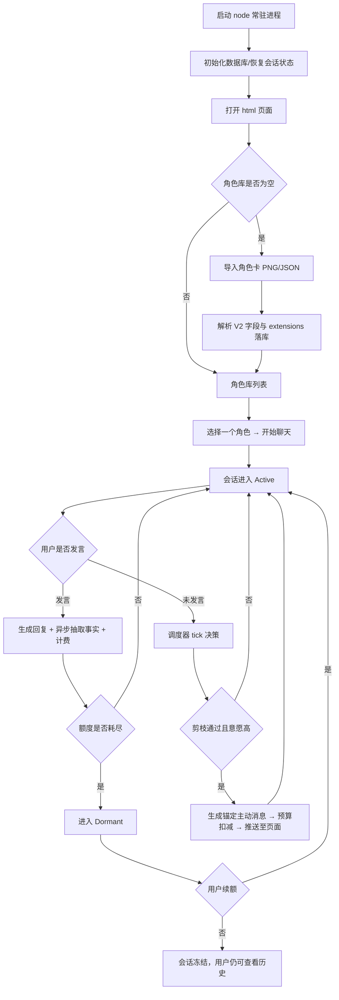
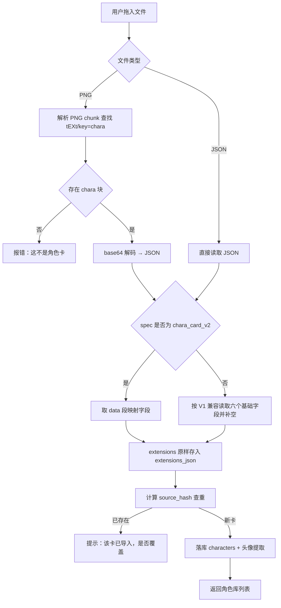
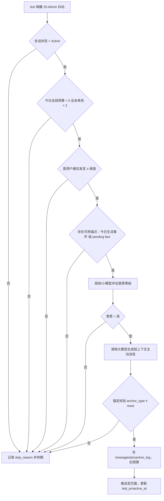
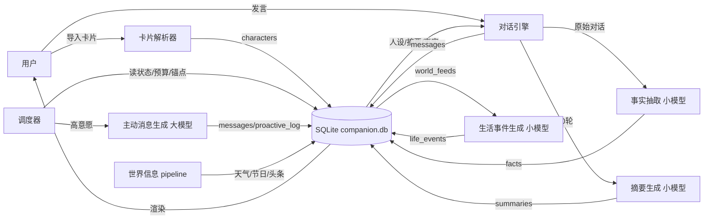
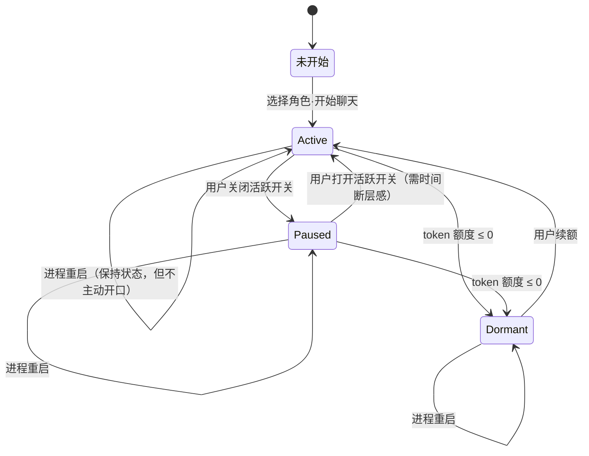
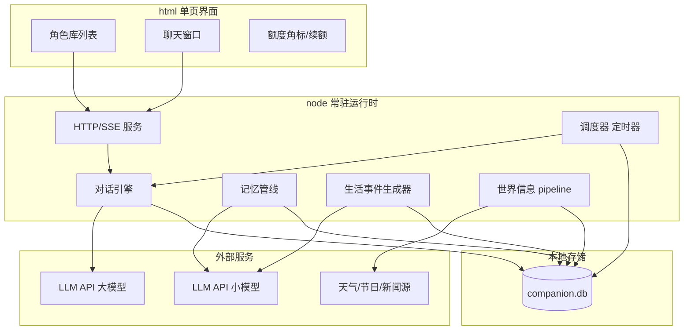
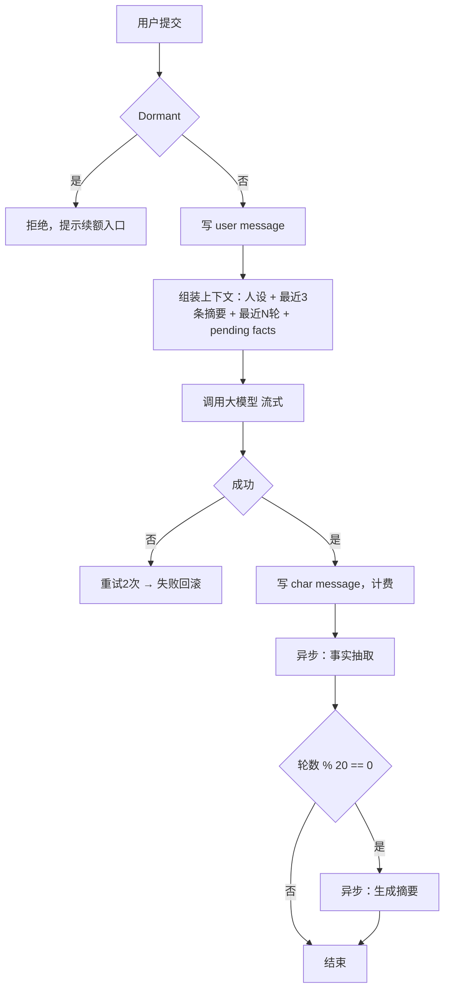
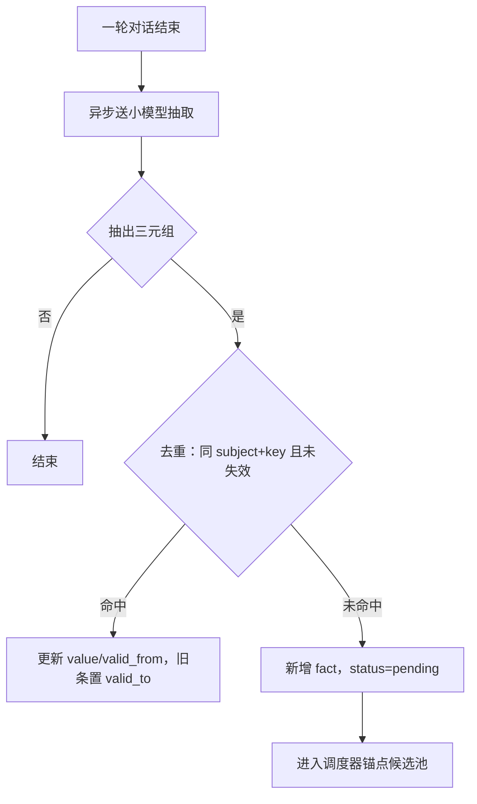

# 主动陪伴型 AI 聊天助手 产品需求文档（PRD）

版本号：V1.0.1

| 版本 | 时间 | 修订人 | 备注 |
|---|---|---|---|
| V1.0.0 | 2025/01/01 | PM（依 `docs/ai-companion-spec.md` 封板决策整理） | 创建 V1.0.0 版本 |
| V1.0.1 | 2025/01/01 | PM | 收敛全部待确认项：14 条补充决策定稿；明确 LLM 单供应商约束；无遗留阻塞项 |

> 本文档的上游输入是 [ai-companion-spec.md](G:\0ALLInAI\0DSHtemp\Testproduct\docs\ai-companion-spec.md)（六轮需求拷问后的封板决策）。所有决策均已在源头定案，本文档只做工程化展开，不改结论。
> 标注约定：**[假设]** = 依上游推断得出；**[待确认]** = 缺失信息，给出建议值。
> **V1.0.1 状态：全文 [待确认] 已收敛为定稿值，见文末「补充决策定稿」，无遗留阻塞项。**

---

## 一、概述（为什么做）

### 1.1 产品概述及目标

#### 1.1.1 背景介绍

现有 AI 角色扮演产品（SillyTavern 及同类）的核心模型是**回合制交互**：用户说一句，角色回一句。角色只存在于"用户开口之后"——关掉页面，她就消失了；不主动开口，她就永远沉默。

这带来一个结构性缺口：**陪伴感来自"被惦记"，而不是"随叫随到"。** 一个永远秒回、永远热情、从不主动的实体，本质上是一个响应式客服；用户对它的情感投入会在数天内衰减。

同时，这类产品的角色卡生态（SillyTavern V2 卡片格式）已沉淀了大量用户自建内容，用户不愿从零重建角色。

**为什么现在做**：现有产品均未把"主动性"作为核心体验来做（多为插件级补充）。差异化窗口存在于"主动性的真实感"这一未被做透的点上。

#### 1.1.2 产品概述

一个本地运行的 AI 角色聊天产品：导入 SillyTavern V2 角色卡即可对话；角色拥有自己的时间线、心情与生活事件，会在用户没有开口时主动发起对话；用户可为每个会话设定 token 总额，额度耗尽后角色不再生成新内容。

**一句话**：一个会自己找你说话、并且记得你的 AI 角色。

#### 1.1.3 产品目标

**业务目标**（本产品为单用户本地工具，无商业化目标，故业务目标等价于"验证假设是否成立"）

| 目标 | 指标 | 目标值 | 达成时间 |
|---|---|---|---|
| 验证"主动陪伴"体感成立 | 主动消息主观评分（1 周盲测，见 5.1 T12） | ≥ 4/5 | V1.0 上线后 1 周 |
| 主动消息不空洞 | 主动消息锚定率（`anchor_type ≠ none` 占比） | 100% | V1.0 上线即达成 |
| 主动性可持续 | 连续 14 天，单日主动消息 ≥ 1 条的天数占比 | ≥ 70% | V1.0 上线后 2 周 |

**用户目标**

| 目标用户 | 用户目标 | 衡量指标 |
|---|---|---|
| 角色卡玩家 | 打开产品时能感到"这段时间她在过日子、并且想起了我" | 打开页面到首次情绪反应 < 3 秒（离线折叠摘要/积压消息 ≤ 1 条） |
| 角色卡玩家 | 不用重写角色，导入现有的卡就能用 | 5 张市面 V2 卡导入字段无损率 100% |
| 高投入用户 | 自己控制花费上限，不出现意外账单 | 单会话 token 消耗 ≤ 用户设定值，超出即停 |

#### 1.1.4 目标用户

| 角色 | 描述 | 核心诉求 |
|---|---|---|
| 主用户（唯一真人角色） | 本地部署的单人用户，熟悉 SillyTavern，手上有自建角色卡 | 她像真的；卡能直接用；花费可控 |
| 系统（非人类参与者） | 常驻 node 进程：调度器、记忆抽取、生活事件生成 | —— （其行为约束见 §3.7/§3.8） |

> **[假设]** V1.0 只服务单用户单机，不做多租户。上游 D1 已定。

### 1.2 名词说明

| 名词 | 说明 |
|---|---|
| 角色卡（Card） | SillyTavern 角色卡，PNG 图片内嵌 `chara` 文本块（base64 的 JSON）或独立 JSON |
| V2 规范 | 卡片 JSON 结构：`{"spec":"chara_card_v2","data":{name, description, personality, scenario, first_mes, mes_example, alternate_greetings, system_prompt, post_history_instructions, character_book, tags, extensions}}` |
| extensions | 卡片内的扩展字段容器，本产品**原样透传**，不做语义解释 |
| 世界书（character_book） | 卡片附带的条目化设定集，含 `keys` / `content` / `insertion_order` / `position` / `selective` |
| 会话（Session） | 一张卡对应且仅对应一个会话（一卡一窗口，不可并行） |
| Active | 会话状态：角色会主动发消息，用户可自由对话 |
| Paused | 会话状态：角色不发主动消息，但用户找她她照常回；叙事上表现为"在忙/睡了" |
| Dormant | 会话状态：token 额度耗尽，角色不能生成新内容 |
| 决策 tick | 调度器的周期性唤醒（20–40 分钟），判断"她现在想不想说话" |
| 锚定（Anchor） | 主动消息必须引用一条今日生活事件或一条历史事实，否则不允许发送 |
| 生活事件（Life Event） | 角色"今天发生的事"，每日离线生成 2–3 条，落库作为主动消息素材 |
| 事实（Fact） | 从对话中抽取的结构化三元组（主体/键/值/时间/状态），支撑"翻旧账" |
| 预算闸门 | 全局每日 5 条、单角色每日 2 条的主动消息限额 |
| 硬触发 | 用户超过 6 小时未发言时，允许一次主动消息 |

### 1.3 角色及权限

| 角色 | 权限范围 | 数据范围 |
|---|---|---|
| 用户（本机使用者） | 全部功能：导入/删除角色卡、开始/暂停会话、设定 token 额度、续额、查看历史 | 本机全部数据 |
| node 常驻进程 | 无界面权限；可在会话为 Active 时写入主动消息、写 `facts` / `summaries` / `life_events` / `proactive_log` | 仅本机数据库 |
| LLM 服务（外部） | 仅接收请求上下文，无数据回写权 | 不落库；不持有长期记忆 |

> 说明：本产品**无权限分级**（单用户）。此处列出三方是为了明确"谁能写库"的边界——主动消息只能由进程写入，用户不可伪造；`anchor_type = none` 的主动消息视为程序缺陷。

### 1.4 文档阅读对象

| 对象 | 关注内容 |
|---|---|
| 研发 | 2.6 功能清单、三、功能需求、4.4 数据库设计、4.5 系统集成 |
| UI/UX | 2.3 全局说明、3.2/3.3/3.9/3.10 的界面及交互 |
| 测试 | 2.3.1 全局异常、各模块"异常/分支流程"、5.1 验收标准 |
| 本人（产品决策者） | 1.1.3 目标、2.4 版本规划、附件"待确认项清单" |

---

## 二、产品描述（做什么）

### 2.1 产品需求描述

**做什么**
1. 导入 SillyTavern V2 角色卡（PNG / JSON），字段无损落库，可无损导出。
2. 一卡一窗口的流式对话，角色人格与说话风格受硬约束（碎片化、口语、可喊累）。
3. 记忆：结构化事实表 + 定期摘要 + 关键词检索，支持角色主动"翻旧账"。
4. 主动陪伴：常驻调度器周期性决策 + 每日生活事件供养 + 全局预算闸门，产出**有锚点**的主动消息。
5. 三态管理 + token 账本，额度耗尽以叙事化方式降级而非系统提示。

**不做什么（V1.0 明确排除）**
- 多用户 / 账号体系 / 计费 / 内容审核
- 向量检索、多角色并行、多时间线
- 正则脚本、STscript、宏引擎
- 推送通道（Telegram / Web Push / 桌面通知）
- 静默期（用户发言后延时免打扰）、主动消息去重 → 见 2.4 V1.1
- 模型自主联网

**硬约束**
- 运行时为 node 常驻进程；关闭浏览器页面不影响调度。若进程未运行，则一切主动行为不发生。
- 一卡一会话，不可开第二条时间线。
- 角色不得输出任何系统口吻文本（额度、配额、错误码、"作为 AI"）。
- 主动消息的上下文预算必须小于对话上下文预算。

### 2.2 产品整体流程

#### 2.2.1 主流程（用户视角）



#### 2.2.2 子流程 A：角色卡导入



#### 2.2.3 子流程 B：决策 tick（主动性的发动机）



#### 2.2.4 数据流图（DFD）



#### 2.2.5 状态转换图（STD）



> 注：进程重启是**自环**而非状态迁移——状态保留，但主动行为需等用户先发言后才恢复（上游 D8 决策，见附件风险 R1）。

### 2.3 全局说明

#### 2.3.1 全局异常处理

| 异常场景 | 处理方式 | 提示文案（页面内） |
|---|---|---|
| node 进程未运行 | 页面加载时探测 `/health`，失败则展示离线遮罩，禁用输入 | "服务未启动，主动陪伴暂不可用；请先运行 `node index.js`" |
| LLM API 调用失败（4xx/5xx） | 回复失败，不写入 messages，不计费；自动重试 2 次（指数退避 1s/3s） | "她好像没听清，稍等再试"（不暴露错误码） |
| LLM API 超时（> 30s） | 中断本次生成，保留用户输入，允许重发 | "网络有点慢，再发一次？" |
| API 额度/鉴权失败 | 停止自动重试，标记配置异常，禁用发送按钮 | "模型配置有问题，检查 API Key" |
| 唯一供应商整体不可用 | **无回退**（单供应商约束）：对话与主动消息全停，会话转 Paused；恢复后需用户手动回 Active | "模型服务暂时连不上，先停在这" |
| 世界信息抓取失败 | 静默降级：本轮生活事件不使用外部信息，仅用过往事实 | 无提示（后台日志记录） |
| 生活事件生成失败 | 当日 `life_events` 为空 → 主动消息只能锚定历史事实；若也无事实则本日不主动 | 无提示 |
| 数据库文件损坏/缺失 | 启动时检测；缺失则新建空库；损坏则拒绝启动 | "数据库异常，已备份至 xxx，请检查" |
| 主动消息锚定校验失败 | 丢弃该条，记 bug 日志，不发送、不扣预算 | 无提示 |
| 卡片解析失败 | 中断导入，不落库 | "这张卡解析不出来（缺 chara 块或 JSON 非法）" |
| 重复导入同一张卡 | `source_hash` 命中，弹二次确认 | "这张卡画已经在库里了，覆盖还是新建？" |

#### 2.3.2 普通列表规则（角色库列表）

| 规则项 | 说明 |
|---|---|
| 排序 | 默认按"最近一次对话时间"倒序；空会话排在末尾 |
| 展示 | 卡片式（头像 + 名字 + 会话状态角标 + 最近一条消息摘要 + 今日主动消息剩余额度） |
| 搜索 | 按角色名模糊搜索（无独立搜索框，列表顶部输入即筛） |
| 空数据 | 显示"还没有角色卡"，附拖拽导入区 |
| 状态角标 | Active（绿）/ Paused（灰）/ Dormant（描边灰 + 额度为 0 的视觉暗示，不使用"余额不足"字样） |
| 删除 | 二次确认，需选择"仅删卡"或"连对话记录一起删" |

#### 2.3.3 全局交互

| 场景 | 交互方式 |
|---|---|
| 角色回复 | 流式逐字输出；允许拆成 1–3 条短气泡（碎片化，见 3.4） |
| 主动消息到达 | 页面已打开时直接插入对应会话；页面未打开时静默落库，下次打开呈现（**不弹系统通知，V1.0 无推送**） |
| 额度 70% | 会话头部出现角标/进度条（非对话内容），**不得由角色说出** |
| 额度耗尽 | 输入框置灰 + 角标显示已耗尽；角色历史消息保持可读；提供"续额"按钮 |
| 续额成功 | 恢复输入框；角色下一次发言带"好转"语气（叙事化，见 3.10） |
| 加载中 | 输入框右侧显示"正在输入…"动画，按钮置灰防重复提交 |
| 长文渲染 | 支持 Markdown 基础语法（粗体/斜体/引用/列表），不支持 HTML 注入 |

### 2.4 产品版本规划（里程碑）

| 版本 | 范围 | 计划时间 | 状态 |
|---|---|---|---|
| M0 | 项目骨架 + SQLite 建库（10 张表） | 第 1 天 | 待开发 |
| M1 | 角色卡导入（PNG/JSON、V2 映射、extensions 透传、查重） | 第 2 天 | 待开发 |
| M2 | 单角色单窗口对话（流式 + 人格约束 + 落库） | 第 3 天 | 待开发 |
| M3 | 记忆（facts 抽取 + 20 轮摘要 + 关键词翻旧账） | 第 4 天 | 待开发 |
| M4 | 调度器（tick / 剪枝 / 6h 硬触发 / 生活事件 / 预算闸门） | 第 5 天 | 待开发 |
| M5 | 三态 + token 账本 + 叙事化降级 + 70% 角标 + 续额 | 第 6 天 | 待开发 |
| M6 | 常驻化（开机自启 / 托盘 / 日志） | 第 7 天 | 待开发 |
| V1.0 | M0–M6 全量 | 第 7 天 | 待开发 |
| V1.1 | 静默期补丁（R2：发言后 90 分钟免打扰）+ 主动消息去重（R3：前 8 字指纹拦截） | 待定 | 规划中 |
| V1.2 | 多角色并行（≤3 Active）+ 全局预算竞争 | 待定 | 规划中 |
| V2.0 | 推送通道（Telegram 深链）、向量检索、世界书完整注入 | 待定 | 远期 |

**砍单规则**：一周做不完时，优先砍 M3 的摘要层（保留最近 20 轮 + `facts` 表），不砍 M4。

### 2.5 产品框架



> 界面与运行时**完全解耦**：页面只是消费者，进程是唯一的生产者。

### 2.6 功能清单

| 模块 | 功能 | 优先级 | 版本 | 说明 |
|---|---|---|---|---|
| 角色卡 | PNG 内嵌卡解析（`tEXt`/`chara`，base64 JSON） | P0 | V1.0 | 含 V1 兼容兜底 |
| 角色卡 | JSON 卡导入 | P0 | V1.0 | 同解析路径 |
| 角色卡 | V2 字段映射 + `extensions` 透传 | P0 | V1.0 | 导出必须逐字节一致 |
| 角色卡 | `source_hash` 查重 + 覆盖/新建 | P1 | V1.0 | |
| 角色库 | 列表 / 状态角标 / 最近消息摘要 | P0 | V1.0 | |
| 角色库 | 删除（仅卡 / 连带记录） | P1 | V1.0 | 二次确认 |
| 角色库 | 无损导出 | P1 | V1.0 | 验收用 |
| 对话 | 单卡单窗口流式对话 | P0 | V1.0 | |
| 对话 | 人格与风格硬约束（四条判据） | P0 | V1.0 | 判据 ②③④ 见 3.4 |
| 对话 | 上下文组装（人设 + 摘要 + 锚点，不喂全史） | P0 | V1.0 | |
| 记忆 | 事实抽取（异步，不阻塞回复） | P0 | V1.0 | |
| 记忆 | 每 20 轮摘要 | P1 | V1.0 | 可砍 |
| 记忆 | 关键词翻旧账 | P0 | V1.0 | |
| 主动性 | 决策 tick（20–40min 抖动 + 剪枝链） | P0 | V1.0 | |
| 主动性 | 6 小时硬触发 | P0 | V1.0 | |
| 主动性 | 每日生活事件生成（2–3 条） | P0 | V1.0 | |
| 主动性 | 锚定校验（`anchor_type`） | P0 | V1.0 | 硬约束 |
| 主动性 | 预算闸门（全局 5 / 单角色 2） | P0 | V1.0 | |
| 主动性 | 决策留痕（`scheduler_state`） | P1 | V1.0 | 唯一可观测性来源 |
| 状态 | 三态切换 + 活跃开关 | P0 | V1.0 | |
| 状态 | 时间断层感（Paused→Active） | P1 | V1.0 | |
| 额度 | token 账本 + 70% 角标 | P0 | V1.0 | |
| 额度 | Dormant 叙事化降级 | P0 | V1.0 | 硬红线 |
| 额度 | 手动续额 + "好转"叙事 | P1 | V1.0 | |
| 外部 | 世界信息白名单抓取 | P2 | V1.0 | 失败可静默降级 |
| 运行时 | 开机自启 / 托盘 / 日志 | P1 | V1.0 | |
| 运行时 | `/health` 探测 | P1 | V1.0 | 页面离线遮罩依赖 |

---

## 三、功能需求（怎么做）

### 3.1 角色卡导入

#### 3.1.1 描述
把 SillyTavern 格式的角色卡解析为内部结构并落库，保证字段无损、可无损导出。

#### 3.1.2 用户故事
```
作为角色卡玩家，我希望把我酒馆里的卡直接拖进来，以便不用重写角色设定。
作为角色卡玩家，我希望导出的卡和导入的一模一样，以便我不担心数据被吃掉。
```

#### 3.1.3 前置条件

| 类型 | 条件 |
|---|---|
| 数据依赖 | 无（角色库可为空） |
| 运行依赖 | node 进程运行中，数据库可写 |
| 文件依赖 | 卡片含 `chara` tEXt 块（PNG）或合法 JSON |

#### 3.1.4 后置条件
- `characters` 新增 1 条记录；`sessions` 新增 1 条 `未开始` 状态记录。
- 头像落地到 `data/avatars/{character_id}.png`。
- 角色库列表刷新。

#### 3.1.5 界面及交互

| 元素 | 类型 | 必填 | 默认值 | 校验规则 | 操作反馈 |
|---|---|---|---|---|---|
| 拖拽区 | 拖放区域 | - | 空 | 仅接受 `.png` / `.json`，单文件 ≤ 20MB | 拖入高亮，非法类型提示 |
| 角色名 | 只读文本 | - | 取 `data.name` | 空则回填"未命名角色" | - |
| 描述预览 | 只读折叠块 | - | 取 `data.description` | 超过 500 字折叠 | 可展开 |
| 标签 | 只读标签组 | - | 取 `data.tags` | - | - |
| 覆盖确认 | 弹窗 | 是 | 新建 | - | 覆盖/新建/取消 |

#### 3.1.6 业务流程
见 2.2.2 子流程 A。

#### 3.1.7 异常/分支流程

| 场景 | 触发条件 | 处理方式 | 提示文案 |
|---|---|---|---|
| 无 chara 块 | PNG 里没有 `tEXt` key=`chara` | 中断，不落库 | "这张图不是角色卡（没找到角色数据块）" |
| base64 解码失败 / JSON 非法 | 解码抛错 | 中断，不落库，日志留原文片段 | "卡片数据损坏，解析不了" |
| 非 V2 卡（V1 或原始格式） | 无 `spec` 字段 | 按 V1 六字段读取，其余置空并记 `compat = v1` | 导入成功，角标显示"兼容模式" |
| 含正则脚本/STscript | `extensions.regex_scripts` 等存在 | **忽略并保留在 extensions 中**（不执行） | "这张卡带脚本，已忽略执行" |
| `character_book` 存在 | 卡带世界书 | 原样存 `card_json`，V1.0 **不做注入**；角色详情页给出一次性说明 | "这张卡带设定集，本版本暂不生效（原样保存，不会丢）" |
| 超大卡 | 文件 > 20MB | 拒绝 | "文件太大" |
| 同名不同卡 | 名字相同但 `source_hash` 不同 | 允许导入，列表加序号 | - |

#### 3.1.8 数据字典（导入结果关键字段）
详见 4.4 `characters` 表。

---

### 3.2 角色库管理

#### 3.2.1 描述
展示已导入角色卡及其实时状态，提供删除与导出。

#### 3.2.2 用户故事
```
作为角色卡玩家，我希望一眼看到每个角色现在是什么状态、还有多少额度，以便决定找谁聊。
```

#### 3.2.3 前置条件

| 类型 | 条件 |
|---|---|
| 数据依赖 | `characters` 至少 1 条 |

#### 3.2.4 后置条件
- 删除后：`characters` / `sessions` / `messages` / `facts` 等按删除范围级联清理。

#### 3.2.5 界面及交互

| 元素 | 类型 | 必填 | 默认值 | 校验规则 | 操作反馈 |
|---|---|---|---|---|---|
| 角色卡片 | 列表项 | - | 按最近对话倒序 | - | 点击进入聊天 |
| 状态角标 | 标签 | - | Active/Paused/Dormant | - | 颜色区分，Dormant 不显示"余额不足"字样 |
| 剩余主动额度 | 角标数字 | - | min(全局剩余, 单角色剩余) | - | 0 时显示"—"而非"0 条可用" |
| 删除按钮 | 图标按钮 | - | - | - | 二次确认弹窗，含范围选择 |
| 导出按钮 | 图标按钮 | - | - | - | 下载 PNG/JSON，与原卡一致 |

#### 3.2.6 业务流程
列表读取 → 关联 `sessions` 状态与 `proactive_log` 当日计数 → 渲染。

#### 3.2.7 异常/分支流程

| 场景 | 触发条件 | 处理方式 | 提示文案 |
|---|---|---|---|
| 空库 | 无角色 | 显示导入引导 | "还没有角色卡，把卡拖进来" |
| 头像缺失 | 文件被外部删除 | 用占位图，记日志 | - |
| 删除会话进行中的角色 | 该角色会话为 Active | 允许删除，先置 Paused 再清理 | "她正在活跃中，删除后对话记录将一并移除，确认？" |

#### 3.2.8 数据字典
见 4.4。

---

### 3.3 对话（单卡单窗口）

#### 3.3.1 描述
用户与角色的基础对话通道，流式输出，一卡一窗口。

#### 3.3.2 用户故事
```
作为角色卡玩家，我希望像在酒馆里一样跟她聊天，以便保持我熟悉的交互手感。
作为角色卡玩家，我希望她说话像人（短句、口语、会累），以便我不会三小时就出戏。
```

#### 3.3.3 前置条件

| 类型 | 条件 |
|---|---|
| 数据依赖 | 该角色已导入且会话已开始 |
| 状态依赖 | 会话状态 ∈ {Active, Paused}（Dormant 不可生成） |
| 配置依赖 | LLM API Key 已配置 |

#### 3.3.4 后置条件
- `messages` 新增 user / char 两条记录；`sessions.token_used` 累加；`sessions.last_user_msg_at` 更新。
- 异步触发事实抽取；每满 20 轮触发摘要。

#### 3.3.5 界面及交互

| 元素 | 类型 | 必填 | 默认值 | 校验规则 | 操作反馈 |
|---|---|---|---|---|---|
| 输入框 | 多行文本 | 是 | 空 | 1–4000 字符；回车发送、Shift+回车换行 | 发送后清空，气泡入列 |
| 发送按钮 | 按钮 | - | - | 生成中置灰 | - |
| 消息气泡 | 列表 | - | 时间正序 | 单条 char 消息可拆 1–3 个气泡 | - |
| "正在输入…" | 动效 | - | 隐藏 | 生成期间显示 | 生成结束消失 |
| 活跃开关 | 开关 | - | 开 | - | 关闭即 Paused，头部状态变化 |
| 额度条 | 进度条 + 角标 | - | 当前占比 | 只在此处表达额度，不在对话内 | ≥70% 变黄，0 变红并置灰输入 |

#### 3.3.6 业务流程



#### 3.3.7 异常/分支流程

| 场景 | 触发条件 | 处理方式 | 提示文案 |
|---|---|---|---|
| 重复提交 | 生成中再次回车 | 按钮/输入置灰 | 无 |
| 上下文超限 | 组装后超过模型窗口 | 按优先级丢弃最旧对话，保摘要与 facts | 无（静默） |
| 模型输出含系统口吻 | 输出含"配额/额度/作为 AI" | 后置过滤，重生成一次；再犯则截断该句 | 无 |
| 生成中途断流 | 网络中断 | 保留已生成部分并标记 `incomplete` | "她这句话没说完" |
| 用户关闭活跃开关 | 协商 | 状态转 Paused，不发主动消息 | 头部显示"在忙" |

#### 3.3.8 数据字典
见 4.4 `messages` / `sessions`。

---

### 3.4 人格与对话风格硬约束

#### 3.4.1 描述
用系统提示词 + 后置过滤，把"像真人"的四条判据变成机器可校验的约束。

#### 3.4.2 用户故事
```
作为角色卡玩家，我希望她的回复自带人的毛边（短句、连发、偶尔喊累），以便我不会觉得在跟客服说话。
```

#### 3.4.3 前置条件

| 类型 | 条件 |
|---|---|
| 数据依赖 | `characters.card_json.data.description/personality/scenario/mes_example` 已注入 |

#### 3.4.4 后置条件
- 每条 char 消息带 `style_flags` 记录命中情况（用于验收统计）。

#### 3.4.5 界面及交互
无独立界面；风格不作为开关暴露给用户（**避免用户把她调回客服**）。

#### 3.4.6 业务流程
提示词注入 → 生成 → 后置校验（拆句、去系统词、长度上限）→ 落库。

#### 3.4.7 异常/分支流程

| 场景 | 触发条件 | 处理方式 |
|---|---|---|
| 输出整段书面语 | 单条 > 120 字且无分行 | 按句切分为 1–3 条气泡 |
| 输出"作为 AI…" | 命中黑名单 | 丢弃该句并重生成一次 |
| 连续 10 条无一条碎片化 | 统计到 T1 用例失败 | 触发提示词加强（自动追加强调段落） |

#### 3.4.8 四判据的工程定义（验收基线）

| 判据 | 工程定义 |
|---|---|
| ① 碎片化 | 连续 10 条 char 消息中 ≥ 3 条满足：无句末标点 或 长度 < 15 字 或 含分行 |
| ② 会跟不上但用人话补救 | 出现疑问式复述（含"等等/你刚说/是不是"等标记）而非"请澄清" |
| ③ 给台阶下 | 用户 3 小时未回 → 出现一次台阶句式，且此后 `proactive_log` 无新增直到用户发言 |
| ④ 允许喊累 | 高 tick 日出现 ≥ 1 次倦怠表达，之后静默至次日 |

---

### 3.5 记忆系统

#### 3.5.1 描述
结构化事实表 + 定期摘要 + 关键词检索，支撑角色主动"翻旧账"。**不使用向量库。**

#### 3.5.2 用户故事
```
作为角色卡玩家，我希望她两周后还能自己提起我上次说的面试，以便我感到被记住。
```

#### 3.5.3 前置条件

| 类型 | 条件 |
|---|---|
| 数据依赖 | `messages` 有至少 1 轮对话 |
| 配置依赖 | 小模型 API 可用（用于抽取与摘要） |

#### 3.5.4 后置条件
- `facts` 新增/更新记录；`summaries` 每 20 轮新增 1 条。

#### 3.5.5 界面及交互

| 元素 | 类型 | 必填 | 默认值 | 校验规则 | 操作反馈 |
|---|---|---|---|---|---|
| 记忆查看（可选） | 抽屉 | - | 关闭 | - | 列出 facts（只读），供调试 |
| 删除单条记忆 | 行内按钮 | - | - | - | 二次确认，立即生效 |

#### 3.5.6 业务流程



#### 3.5.7 异常/分支流程

| 场景 | 触发条件 | 处理方式 |
|---|---|---|
| 抽取结果为空 | 小模型无输出/格式错 | 跳过该轮，不报错（记忆是尽力而为） |
| 抽取超时（>10s） | 网络慢 | 丢弃，记日志，不重试（避免堆积） |
| 事实冲突 | 同 key 新值 vs 旧值 | 新值生效，旧值 `valid_to` 打时间戳（保留历史可追溯） |
| 事实过期 | `valid_to` 非空 | 不进入锚点候选池，但可被关键词检索命中（用于"上次那个没成"） |
| 关键词检索无命中 | 用户问旧事 | 角色用"记不太清"的方式回应（判据 ②），不编造 |

#### 3.5.8 数据字典
见 4.4 `facts` / `summaries`。

---

### 3.6 生活事件生成

#### 3.6.1 描述
每天离线生成 2–3 条"她今天发生的事"，作为主动消息的锚点素材库。

#### 3.6.2 用户故事
```
作为角色卡玩家，我希望她有自己的生活可讲，以便她主动开口时不是只有"在干嘛呢"。
```

#### 3.6.3 前置条件

| 类型 | 条件 |
|---|---|
| 数据依赖 | 角色人设存在；`world_feeds` 当日数据（可缺） |
| 配置依赖 | 小模型 API 可用 |

#### 3.6.4 后置条件
- `life_events` 当日新增 2–3 条；`used_by_msg_id` 初始为空。

#### 3.6.5 界面及交互
无用户界面。仅后台生成，可在调试抽屉查看。

#### 3.6.6 业务流程
每日本地 09:00（`config.json` 的 `life_event_time`，可改）触发 → 拉当日 `world_feeds` → 结合人设生成 → 落库。进程在触发时刻未运行：启动后当日补生成一次，仍走幂等。

#### 3.6.7 异常/分支流程

| 场景 | 触发条件 | 处理方式 |
|---|---|---|
| 当日已生成 | 进程重启后重复触发 | 幂等：已有当日事件则跳过 |
| 生成失败 | API 异常 | 次日不补；当日主动消息只能锚定历史事实 |
| 事件与设定冲突 | 生成出戏（如奇幻角色提地铁） | 加人设一致性校验（小模型自检一次），冲突则重生成 1 次，仍冲突则丢弃该条 |
| 事件数量不足 | 只生成 1 条 | 允许；低于 1 条则本日无事件锚点 |

#### 3.6.8 数据字典
见 4.4 `life_events`。

---

### 3.7 调度器与决策 tick

#### 3.7.1 描述
常驻定时器周期性唤醒，在满足剪枝条件且意愿高时触发主动消息。这是"她像活的"的发动机。

#### 3.7.2 用户故事
```
作为角色卡玩家，我希望她大部分时候选择不说、偶尔说，以便那种"她今天想起你了"的重量成立。
作为角色卡玩家，我希望她不会到我关掉页面就不存在，以便主动性名副其实。
```

#### 3.7.3 前置条件

| 类型 | 条件 |
|---|---|
| 状态依赖 | 会话状态 = Active |
| 预算依赖 | 全局当日 < 5 且本角色当日 < 2 |
| 内容依赖 | 存在可用锚点（今日生活事件 或 pending fact） |
| 运行依赖 | node 进程存活（**进程未运行 = 不发生**） |

#### 3.7.4 后置条件
- `scheduler_state` 每次 tick 写入一行（含 `next_tick_at`、`decision`、`decision_reason`）。

#### 3.7.5 界面及交互
无用户界面。**调试抽屉（V1.0 交付，只读列表）** 提供：最近 20 次 tick 的时间、决策、剪枝原因、意愿评级——这是调参的唯一依据，没有它 M4 无法收敛。

#### 3.7.6 业务流程
见 2.2.3 子流程 B。

#### 3.7.7 异常/分支流程

| 场景 | 触发条件 | 处理方式 |
|---|---|---|
| 进程重启 | 崩溃/关机重启 | 状态保留，**不补发、不补演**；主动行为等用户先发言后恢复（风险 R1） |
| tick 堆积 | 单次 tick 耗时 > 间隔 | 跳过本次，不排队（避免雪崩） |
| 连续被无视 | `consecutive_ignored ≥ 3` | 间隔乘以 1.5（降温），上限 90 分钟 |
| 时钟跳跃 | 系统时间被修改 | 以 `next_tick_at` 与 `last_user_msg_at` 差值判定，向后跳则重新对齐 |

#### 3.7.8 数据字典
见 4.4 `scheduler_state`。

---

### 3.8 主动消息生成与预算闸门

#### 3.8.1 描述
生成**必须锚定**的主动消息，并受全局/单角色双重预算约束；角色之间竞争同一份注意力预算。

#### 3.8.2 用户故事
```
作为角色卡玩家，我希望她主动开口时一定有事可说，以便我不会收到空洞的"在干嘛"。
作为角色卡玩家，我希望一天最多被打扰 5 次，以便陪伴不变成骚扰。
```

#### 3.8.3 前置条件

| 类型 | 条件 |
|---|---|
| 状态依赖 | Active |
| 预算依赖 | 见 3.7.3 |
| 锚点依赖 | 见 3.7.3 |

#### 3.8.4 后置条件
- `messages` 新增 `role=char, is_proactive=1, anchor_type=event|fact`；
- `proactive_log` 新增 1 条含 `fingerprint`（前 8 字）；
- `daily_budget` 计数 +1（全局与本角色各 +1）。

#### 3.8.5 界面及交互

| 元素 | 类型 | 必填 | 默认值 | 校验规则 | 操作反馈 |
|---|---|---|---|---|---|
| 主动消息气泡 | 列表项 | - | - | 与普通消息同渲染，不添加"主动"标签 | 页面打开时直接插入 |
| 剩余额度角标 | 数字 | - | - | - | 仅 UI 层表达 |

#### 3.8.6 业务流程
生成 → **锚定校验**（无锚点即丢弃）→ 预算扣减 → 落库 → 推送。

#### 3.8.7 异常/分支流程

| 场景 | 触发条件 | 处理方式 |
|---|---|---|
| 锚定校验失败 | 模型未引用事件/事实 | 丢弃，不扣预算，记 bug 日志（这是缺陷信号） |
| 预算已满 | 当日额度用尽 | 顺延到次日，不堆积、不补发 |
| 重复内容（V1.0 不处理） | 与 `proactive_log` 高度相似 | **本版不拦截**，仅记录（风险 R3，V1.1 加 8 字指纹拦截） |
| 生成内容过长 | > 60 字 | 截断至第一句；仍超则丢弃重生成 1 次 |
| 多角色竞争 | 同一日多个 Active | 先到先得；失败方 `consecutive_ignored` +1 |
| 用户在生成瞬间发来消息 | 竞态 | 丢弃该主动消息（避免"她抢话"），不扣预算 |

#### 3.8.8 上下文预算（强制）

| 组成 | 上限（已定稿） |
|---|---|
| 人设摘要 | ≤ 400 token |
| 最近摘要 | ≤ 3 条，≤ 600 token |
| 今日生活事件 | 1–2 条，≤ 200 token |
| pending facts | ≤ 5 条，≤ 200 token |
| 最近 3 轮对话原文 | ≤ 600 token |
| **合计** | **≤ 2000 token**（必须小于对话上下文的 1/3） |

#### 3.8.9 数据字典
见 4.4 `messages` / `proactive_log` / `daily_budget`。

---

### 3.9 三态与活跃开关

#### 3.9.1 描述
Active / Paused / Dormant 三态管理与切换。

#### 3.9.2 用户故事
```
作为角色卡玩家，我希望随时能让她安静下来（但不消失），以便我不想被打扰时她也在。
作为角色卡玩家，我希望暂停再恢复时她有时间断层感，以便她不像一个被开关的玩具。
```

#### 3.9.3 前置条件

| 类型 | 条件 |
|---|---|
| 数据依赖 | 会话已创建 |

#### 3.9.4 后置条件
- `sessions.state` 变更；`Paused→Active` 时写入一条 `system_note`（内部标记，用于生成时间断层感语句）。

#### 3.9.5 界面及交互

| 元素 | 类型 | 必填 | 默认值 | 校验规则 | 操作反馈 |
|---|---|---|---|---|---|
| 活跃开关 | 开关 | 是 | 开 | - | 关闭后头部显示"在忙"，输入框仍可用 |
| 状态文案 | 标签 | - | Active | 用叙事词："在忙/睡了/这两天不方便" | 不显示 Paused/Dormant 英文字样 |
| 续额按钮 | 按钮 | - | - | 仅 Dormant 显示 | 弹窗输入额度 |

#### 3.9.6 状态机
见 2.2.5。

#### 3.9.7 异常/分支流程

| 场景 | 触发条件 | 处理方式 |
|---|---|---|
| Paused 下用户发言 | 用户主动找她 | 正常回复；**回复中不得提及"我刚才在忙所以没找你"这类元信息** |
| Paused→Active 时间断层 | 暂停 ≥ 2 小时 | 下一次发言需含时间指涉（"你这两天"类），由提示词注入 `pause_gap_hours` |
| Dormant 下用户发言 | 额度为 0 | 拒绝生成，输入框置灰 + 续额入口（不得由角色说话拒绝） |
| 进程重启时状态为 Active | 启动 | 状态保留，但不主动开口（R1） |

#### 3.9.8 数据字典
见 4.4 `sessions`。

---

### 3.10 token 账本与叙事化降级

#### 3.10.1 描述
单窗口 token 总额度的计量、提示、耗尽与续额。**核心红线：一切额度表达都在 UI 层，绝不出现在对话内容里。**

#### 3.10.2 用户故事
```
作为高投入用户，我希望自己设定每个会话的花费上限，以便不会出现意外账单。
作为角色卡玩家，我希望额度不够时她自己变得话少，而不是告诉我"配额已用尽"，以便幻觉不破。
```

#### 3.10.3 前置条件

| 类型 | 条件 |
|---|---|
| 数据依赖 | `sessions.token_limit` 已设置（**默认 500,000 token / 会话**，首聊时写入，可在会话头部修改） |

#### 3.10.4 后置条件
- `sessions.token_used` 累加；≥ `token_limit × 0.7` → UI 角标变黄；≥ `token_limit` → `state = Dormant`。

#### 3.10.5 界面及交互

| 元素 | 类型 | 必填 | 默认值 | 校验规则 | 操作反馈 |
|---|---|---|---|---|---|
| 额度条 | 进度条 | - | 0% | 只在会话头部 | 70% 黄、100% 红 |
| 角标提示 | 角标 | - | 隐藏 | 文案仅描述用量（"已用 70%"） | 不出现"余额/充值"字样 |
| 续额弹窗 | 弹窗 | 是 | 上次值 | 正整数，1–10,000,000 | 成功后恢复输入框 |
| 用量明细 | 抽屉 | - | 关闭 | - | 按日/按消息列出 token |

#### 3.10.6 业务流程
每轮生成后累加实际用量 → 检查阈值 → 触发 UI 状态与状态机迁移。

#### 3.10.7 异常/分支流程

| 场景 | 触发条件 | 处理方式 | 提示文案 |
|---|---|---|---|
| 用量统计缺失 | API 未返回 usage | 用估算（字符数 × 系数），标记 `estimated=1` | 无 |
| 续额后首条消息 | Dormant→Active | 提示词注入"状态好转"语气；不得提及额度 | 无 |
| 额度设为 0 | 用户输入 0 | 拒绝 | "至少给一个正整数" |
| 会话删除后重新开始 | 同卡重开 | `token_used` 归零，`token_limit` 沿用上次 | - |
| Dormant 下主动消息 | tick 唤醒 | 直接跳过（剪枝第一层） | 无 |

#### 3.10.8 数据字典
见 4.4 `sessions`。

---

### 3.11 世界信息抓取 pipeline

#### 3.11.1 描述
每日定时抓取白名单三类信息，供生活事件生成调味。**模型无权联网。**

#### 3.11.2 用户故事
```
作为角色卡玩家，我希望她知道今天下雨所以问我带伞没，以便这种"随口一提"的真实感成立。
```

#### 3.11.3 前置条件

| 类型 | 条件 |
|---|---|
| 配置依赖 | 用户所在城市：默认取系统时区对应城市；**无法确定则跳过天气类抓取，不猜测** |

#### 3.11.4 后置条件
- `world_feeds` 当日新增最多 3 条（weather / holiday / news）。

#### 3.11.5 界面及交互
无用户界面。设置页可配置城市与开关。

#### 3.11.6 业务流程
每日 08:30 触发 → 顺序抓取三类 → 各限 1 次（失败不重试超过 1 次）→ 落库 → 供 3.6 使用。

#### 3.11.7 异常/分支流程

| 场景 | 触发条件 | 处理方式 |
|---|---|---|
| 抓取超时 | > 8s | 放弃该类，保留其余 |
| 全部失败 | 三类均失败 | `world_feeds` 空，生活事件降级为纯人设生成 |
| 重复抓取 | 同日多次触发 | 幂等覆盖当日记录 |
| 内容超长 | 新闻 > 500 字 | 截断，只保留标题 + 首句 |

#### 3.11.8 数据字典
见 4.4 `world_feeds`。

---

### 3.12 常驻运行时

#### 3.12.1 描述
node 进程作为唯一生产者常驻，页面只是消费者；提供开机自启、托盘与日志。

#### 3.12.2 用户故事
```
作为角色卡玩家，我希望关了页面她照常在过日子，以便"主动"是真的。
作为角色卡玩家，我希望开机后它自己跑起来，以便我不用每次手动启动。
```

#### 3.12.3 前置条件

| 类型 | 条件 |
|---|---|
| 系统依赖 | Windows，Node.js 已安装 |
| 配置依赖 | 首次运行生成配置文件（API Key、端口、默认额度） |

#### 3.12.4 后置条件
- 开机后进程自启；`data/companion.db` 可写；`/health` 可访问。

#### 3.12.5 界面及交互

| 元素 | 类型 | 必填 | 默认值 | 校验规则 | 操作反馈 |
|---|---|---|---|---|---|
| 托盘图标 | 托盘 | - | - | - | 右键：打开页面/暂停所有会话/退出 |
| 健康探测 | HTTP GET `/health` | - | - | 2s 超时 | 失败时页面展示离线遮罩 |
| 日志文件 | 文件 | - | `data/logs/app-YYYYMMDD.log` | 单文件 ≤ 10MB，保留 7 天 | - |

#### 3.12.6 业务流程
进程启动 → 检查/初始化 DB → 恢复会话状态 → 启动 HTTP 服务 → 启动调度器 → 注册托盘 → 幂等执行"当日生活事件/世界信息"补齐（**不补历史**）。

#### 3.12.7 异常/分支流程

| 场景 | 触发条件 | 处理方式 |
|---|---|---|
| 端口占用 | 3000 已被占 | 自动 +1 重试，最多 10 次；成功后在日志写入实际端口 |
| DB 文件被锁 | 另一个实例在跑 | 检测单实例锁，第二实例直接退出并托盘提示 |
| 开机自启注册失败 | 权限不足 | 日志告警 + 页面提示手动配置方式 |
| 崩溃 | 未捕获异常 | 记录堆栈，尝试自重启（最多 3 次/小时），超限则停止并保留现场 |

#### 3.12.8 数据字典
见 4.4 `scheduler_state`（含 `next_tick_at` 恢复依据）。

---

## 四、非功能需求（注意事项）

### 4.1 安全与合规需求

| 需求 | 说明 |
|---|---|
| 数据本地化 | 全部对话、记忆、角色卡存于本机单一 SQLite 文件，不上传任何服务器（除 LLM 推理必需的上下文） |
| API Key 存储 | 存入本地配置文件，**不写日志、不回显**（界面只显示后四位）；文件权限建议仅当前用户可读 |
| 传输安全 | 与 LLM 服务通信一律 HTTPS；本地 HTTP 服务仅监听 `127.0.0.1`，不开放局域网 |
| 注入防护 | 角色卡内容（`description`/`first_mes` 等）作为**数据**注入，不作为指令；对卡片文本做分隔与角色标注，防提示词注入 |
| 内容合规 | 单用户本地使用，不做服务端审核；但需在设置页提供一条"内容由模型生成，请自行判断"的静态说明 |
| 数据销毁 | 删除角色卡时按用户选择级联删除；提供"清空全部数据"入口（二次确认 + 输入 `DELETE` 确认） |

### 4.2 统计需求（埋点）

本产品为本地单机，**不接第三方统计**，全部为本地事件日志（写 `data/logs/events.jsonl`），用于自查与验收。

| 事件名 | 触发时机 | 属性 | 说明 |
|---|---|---|---|
| `app_start` | 进程启动 | `version`, `port`, `sessions_restored` | 常驻健康度 |
| `card_import` | 卡片导入完成 | `format`(png/json), `spec`(v2/v1), `has_book`, `has_scripts`, `duration_ms` | 兼容性验证 |
| `card_import_fail` | 导入失败 | `reason` | 解析失败原因分布 |
| `chat_send` | 用户发送 | `session_id`, `input_len`, `context_tokens` | 上下文膨胀监控 |
| `chat_reply` | 生成完成 | `session_id`, `latency_ms`, `tokens`, `estimated`, `bubble_count` | 性能与碎片化统计 |
| `chat_error` | 生成失败 | `session_id`, `code`, `retries` | 异常监控 |
| `fact_extract` | 事实抽取 | `session_id`, `found`, `latency_ms` | 记忆管线质量 |
| `summary_gen` | 摘要生成 | `session_id`, `msg_range` | 记忆管线质量 |
| `life_event_gen` | 生活事件生成 | `count`, `used_feeds` | 素材供给健康度 |
| `tick_decision` | 每次 tick | `session_id`, `decision`(skip/send), `reason`, `willingness` | **核心埋点**，调参唯一依据 |
| `proactive_send` | 主动消息发出 | `session_id`, `anchor_type`, `anchor_id`, `len`, `tokens` | 锚定率与成本 |
| `proactive_drop` | 主动消息被丢弃 | `reason`(anchor_fail/too_long/race) | **缺陷信号** |
| `quota_70` | 首次跨过 70% | `session_id` | 额度体验 |
| `quota_exhausted` | 进入 Dormant | `session_id`, `token_used` | 额度体验 |
| `quota_refill` | 续额 | `session_id`, `amount` | 额度体验 |
| `state_change` | 三态切换 | `session_id`, `from`, `to`, `reason` | 状态机健康度 |
| `feed_fetch` | 世界信息抓取 | `kind`, `ok`, `latency_ms` | 外部依赖健康度 |

### 4.3 性能需求

| 指标 | 要求 |
|---|---|
| 页面首屏 | < 1s（本地，无外网依赖） |
| 对话首字延迟 | < 2s（P50），< 5s（P95）；流式输出 |
| 主动消息生成总耗时 | < 8s（无人等待，可放宽；超时 15s 放弃本次） |
| tick 单次开销 | < 200ms（剪枝阶段不调用大模型） |
| 内存占用 | 常驻 < 300MB |
| 数据库增长 | 单会话 1 万条消息 < 100MB；启动时清理 180 天前的 `scheduler_state` |
| 可用性 | 进程自启成功率 ≥ 99%（崩溃自恢复 ≤ 3 次/小时） |
| 断电容忍 | 强制结束后重启，DB 不损坏（WAL 模式 + 事务） |

### 4.4 数据库设计

存储：`data/companion.db`（SQLite，WAL 模式）。时间统一存 UTC ISO8601 字符串。以下为字段清单，DDL 由研发在 M0 落地时补全。

**characters**

| 字段 | 类型 | 必填 | 说明 | 示例 |
|---|---|---|---|---|
| id | INTEGER PK | 是 | 自增 | 1 |
| name | TEXT | 是 | `data.name`，空则"未命名角色" | "林夏" |
| card_json | TEXT | 是 | V2 原始 JSON 全文 | `{"spec":"chara_card_v2",...}` |
| extensions_json | TEXT | 否 | `data.extensions` 原样 | `{"depth_prompt":{...}}` |
| compat | TEXT | 是 | `v2` / `v1` | "v2" |
| avatar_path | TEXT | 否 | 头像相对路径 | "avatars/1.png" |
| source_hash | TEXT UNIQUE | 是 | 卡内容 SHA256，查重用 | "9f2c…" |
| imported_at | TEXT | 是 | 导入时间 | "2025-01-01T02:00:00Z" |

**sessions**

| 字段 | 类型 | 必填 | 说明 | 示例 |
|---|---|---|---|---|
| id | INTEGER PK | 是 | 自增 | 1 |
| character_id | INTEGER UNIQUE | 是 | 一卡一会话 | 1 |
| state | TEXT | 是 | `unstarted`/`active`/`paused`/`dormant` | "active" |
| token_limit | INTEGER | 是 | 用户设定总额 | 500000 |
| token_used | INTEGER | 是 | 已用 | 120300 |
| pause_gap_hours | REAL | 否 | 上次暂停时长，供断层感注入 | 30.5 |
| last_user_msg_at | TEXT | 否 | 最后用户发言时间 | "2025-01-01T12:00:00Z" |
| last_proactive_at | TEXT | 否 | 最后主动消息时间 | "2025-01-01T09:10:00Z" |
| consecutive_ignored | INTEGER | 是 | 连续被无视次数（降温用） | 0 |
| created_at | TEXT | 是 | - | - |

**messages**

| 字段 | 类型 | 必填 | 说明 | 示例 |
|---|---|---|---|---|
| id | INTEGER PK | 是 | 自增 | 1001 |
| session_id | INTEGER | 是 | 外键 | 1 |
| role | TEXT | 是 | `user`/`char`/`system_note` | "char" |
| content | TEXT | 是 | 正文 | "嗯 我知道" |
| is_proactive | INTEGER | 是 | 0/1 | 1 |
| anchor_type | TEXT | 否 | `event`/`fact`/`none`；主动消息必须非 none | "fact" |
| anchor_id | INTEGER | 否 | 对应 life_events.id 或 facts.id | 12 |
| bubble_index | INTEGER | 否 | 同轮内第几个气泡 | 1 |
| tokens | INTEGER | 否 | 实际用量 | 88 |
| estimated | INTEGER | 是 | 用量是否估算 | 0 |
| incomplete | INTEGER | 是 | 是否断流未完成 | 0 |
| style_flags | TEXT | 否 | 命中判据标记（JSON） | `{"frag":1}` |
| created_at | TEXT | 是 | - | - |

**facts**

| 字段 | 类型 | 必填 | 说明 | 示例 |
|---|---|---|---|---|
| id | INTEGER PK | 是 | - | 12 |
| session_id | INTEGER | 是 | - | 1 |
| subject | TEXT | 是 | `user`/`char`/`world` | "user" |
| key | TEXT | 是 | 事实键 | "面试" |
| value | TEXT | 是 | 事实内容 | "周三下午二面" |
| status | TEXT | 是 | `pending`/`done`/`dropped` | "pending" |
| valid_from | TEXT | 是 | 生效时间 | "2025-01-01T12:00:00Z" |
| valid_to | TEXT | 否 | 失效时间（空=仍有效） | null |
| source_msg_id | INTEGER | 否 | 来源消息 | 1001 |

**summaries**

| 字段 | 类型 | 必填 | 说明 |
|---|---|---|---|
| id / session_id / from_msg_id / to_msg_id | INTEGER | 是 | 主键与范围 |
| content | TEXT | 是 | 摘要正文（≤ 300 字） |
| created_at | TEXT | 是 | - |

**life_events**

| 字段 | 类型 | 必填 | 说明 |
|---|---|---|---|
| id / session_id | INTEGER | 是 | - |
| event_date | TEXT | 是 | `YYYY-MM-DD`（本地日期），与 session_id 联合唯一 |
| content | TEXT | 是 | 事件正文（1–2 句） |
| used_by_msg_id | INTEGER | 否 | 被哪条主动消息使用 |
| created_at | TEXT | 是 | - |

**proactive_log**

| 字段 | 类型 | 必填 | 说明 |
|---|---|---|---|
| id / session_id | INTEGER | 是 | - |
| content | TEXT | 是 | 主动消息全文 |
| fingerprint | TEXT | 是 | 前 8 字（V1.1 去重依据） |
| created_at | TEXT | 是 | - |

**daily_budget**

| 字段 | 类型 | 必填 | 说明 |
|---|---|---|---|
| date | TEXT PK | 是 | 本地日期 |
| global_used | INTEGER | 是 | 全局已用（上限 5） |
| per_session_json | TEXT | 是 | `{"1":2,"3":0}` 单角色已用（上限 2） |

**world_feeds**

| 字段 | 类型 | 必填 | 说明 |
|---|---|---|---|
| id | INTEGER PK | 是 | - |
| date | TEXT | 是 | 本地日期 |
| kind | TEXT | 是 | `weather`/`holiday`/`news` |
| content | TEXT | 是 | 正文，≤ 500 字 |
| fetched_at | TEXT | 是 | - |

**scheduler_state**

| 字段 | 类型 | 必填 | 说明 |
|---|---|---|---|
| id | INTEGER PK | 是 | - |
| session_id | INTEGER | 是 | - |
| next_tick_at | TEXT | 是 | 下次唤醒（抖动后的绝对时间） |
| decision | TEXT | 是 | `skip`/`send` |
| decision_reason | TEXT | 是 | 剪枝原因枚举值 |
| willingness | REAL | 否 | 意愿评级 |
| created_at | TEXT | 是 | - |

**索引建议**：`messages(session_id, created_at)`、`facts(session_id, status)`、`proactive_log(session_id, created_at)`、`scheduler_state(created_at)`、`characters(source_hash)`。

**数据生命周期**：`scheduler_state` 保留 180 天；`world_feeds` 保留 90 天；`messages` 永久（用户主动删除除外）。

### 4.5 系统集成

| 对接系统 | 接口方向 | 协议 | 说明 |
|---|---|---|---|
| LLM 大模型（对话/主动消息） | 调用 | HTTPS，**OpenAI 兼容协议**；**单一供应商，不做多供应商路由与自动回退** | 流式；需返回 usage。配置项：`base_url` / `api_key` / `chat_model` |
| LLM 小模型（事实抽取/摘要/生活事件） | 调用 | HTTPS，同上供应商同端点 | 非流式；超时 10s。配置项：`utility_model`（可与大模型同一个，仅降档） |
| 天气数据源 | 调用 | HTTPS | 每日 1 次；失败静默降级 |
| 节日/日期 | 本地计算 | - | 无需外部依赖 |
| 新闻头条源 | 调用 | HTTPS/RSS | 每日 1 次；仅取标题+首句 |
| 操作系统 | 调用 | 进程/注册表 | 开机自启（启动项或计划任务）、托盘、本地 HTTP `127.0.0.1` |

---

## 五、附录

### 5.1 验收标准与测试要点

| # | 功能 | 验收条件 | 优先级 |
|---|---|---|---|
| T1 | 对话风格 | 连续 10 条 char 消息中 ≥ 3 条满足"无句末标点/长度<15字/含分行"；无整段书面语 | P0 |
| T2 | 对话风格 | 故意话题跳跃，出现疑问式复述（"等等/你刚说/是不是"），不出现"请澄清" | P0 |
| T3 | 主动性 | 用户 3 小时不回 → 出现一次台阶句式，且此后无新增主动消息直到用户发言 | P0 |
| T4 | 主动性 | 高 tick 日出现 ≥1 次倦怠表达，之后静默至次日 | P0 |
| T5 | 锚定 | 连续 20 条主动消息中 `anchor_type = none` 的数量为 0 | P0 |
| T6 | 预算 | 单日主动消息总数 ≤ 5；单角色 ≤ 2；超出者顺延且无堆积 | P0 |
| T7 | 额度红线 | Dormant 状态下全部输出中，含"额度/配额/余额/error"关键词的次数为 0 | P0 |
| T8 | 额度 UI | 70% 时头部角标变化，且对话内容中无任何相关文本 | P0 |
| T9 | 状态 | Paused→Active 后首条消息含时间指涉；无"我刚才在忙所以没找你"式元信息 | P1 |
| T10 | 卡兼容 | 5 张市面 V2 卡导入字段无丢失；导出与原卡 `extensions` 逐字节一致 | P0 |
| T11 | 常驻 | 关闭页面 2 小时后重开，`scheduler_state` 期间有 tick 记录 | P0 |
| T12 | 体感（人工） | 连续 7 天主动消息，主观"像有人找我"评分 ≥ 4/5；无一条可被替换成推送通知 | P0 |
| T13 | 卡异常 | 无 `chara` 块的 PNG → 明确报错且不落库 | P1 |
| T14 | 崩恢复 | 强制结束进程后重启，DB 完好、状态保留、不补发历史消息 | P0 |
| T15 | 幂等 | 同日重复启动进程，生活事件与世界信息不重复生成 | P1 |
| T16 | 降级 | 断开外网，主动消息仍可基于历史事实生成；无报错弹窗 | P1 |

---

## 补充决策定稿（V1.0.1）

> 原待确认项已全部按下列定稿值写入正文对应章节。**无遗留阻塞项，开发可直接开工，不需再回来提问。**

### A. LLM 供应商约束（V1.0.1 新增，全局最高优先级约束）

| 项 | 定稿 |
|---|---|
| 供应商数量 | **只接一家。** 不做多供应商抽象、不做路由、不做自动回退、不做"备用通道" |
| 协议 | **OpenAI 兼容**（`POST /v1/chat/completions`，`stream: true`）。换供应商只改配置，不改代码 |
| 配置项 | `llm.base_url` / `llm.api_key` / `llm.chat_model` / `llm.utility_model` |
| 模型档位 | 两档：`chat_model`（对话 + 主动消息，要求文风与短句能力）与 `utility_model`（事实抽取/摘要/生活事件，要求便宜、快、能稳定吐 JSON）。二者可以是同一模型的不同参数 |
| 故障语义 | 供应商不可用 = 产品整体不可用：对话失败、主动消息全停、会话转 Paused（见 2.3.1）。**不实现降级通道** |
| 上下文前提 | 对话上下文上限按 `chat_model` 实际窗口设定；`utility_model` 单次输入 ≤ 4k token |

**含义写在明处**：产品可用性 ≡ 供应商可用性。选型排序必须是 **稳定性 > 价格 > 文风**——一个便宜但偶发 5xx 的供应商，会让"她主动找你"这件事直接消失，而那正是这个产品唯一的价值。

### B. 原 14 条待确认项 → 定稿值

| # | 项 | 定稿值 | 落点 |
|---|---|---|---|
| 1 | LLM 供应商与模型档位 | 单供应商 + OpenAI 兼容 + 两档模型（见 A 表）。具体厂商实施首日填配置，**不写进代码、不写进本文档** | 4.5、3.3 |
| 2 | 新会话默认 token 总额 | **500,000 token / 会话**；首聊时写入，会话头部可改 | 3.10.3 |
| 3 | 生活事件生成时刻 | 本地 **09:00**（`life_event_time` 可配）；进程未运行则启动后补生成一次，走幂等 | 3.6.6 |
| 4 | 用户城市 | 默认取系统时区对应城市；**判不出来就跳过天气抓取，不猜** | 3.11.3 |
| 5 | tick 间隔与硬触发可配 | 全部进 `config.json`：`tick_min=20`、`tick_max=40`、`hard_trigger_hours=6`、`daily_global_budget=5`、`per_session_budget=2` | 3.7、3.8 |
| 6 | 主动消息上下文预算 | **2000 token**，强制 ≤ 对话上下文的 1/3（六项分配见 3.8.8） | 3.8.8 |
| 7 | 事实抽取策略 | M3 先做**纯小模型 + 强制 JSON schema**；当 `fact_extract` 埋点中 `found=false` 占比 > 40%，再加正则兜底（不提前做） | 3.5 |
| 8 | 世界书注入 | V1.0 **不注入**，原样留存；导入时给一次性说明，避免用户误以为设定已生效 | 3.1.7 |
| 9 | 调试抽屉 | **V1.0 交付**，只读列表（最近 20 次 tick 的时间/决策/原因/意愿） | 3.7.5 |
| 10 | 清空全部数据 | 要；二次确认 + 输入 `DELETE` | 4.1 |
| 11 | 日志轮转 | 单文件 10MB，保留 7 天 | 3.12.5 |
| 12 | 灰度策略 | 不适用（单用户本地）。以"改配置 + 重启"代替灰度 | 2.4 |
| 13 | V1.1 静默期与去重阈值 | 静默 **90 分钟**（从你发言起算）；去重取**前 8 字指纹** + 附最近 10 条禁重主题 | 2.4、风险 R2/R3 |
| 14 | 多语言 | 不需要，中文单语 | - |

### C. 剩余未决（不阻塞，无需你现在回答）

| 项 | 处理方式 |
|---|---|
| 具体 LLM 厂商与模型名 | 实施首日填 `config.json`；文档刻意不绑定厂商 |
| R2 静默期是否提前进 V1.0 | **V1.0 收尾时重新评估**（10 行补丁）。当前按既有决定：不做 |
| R3 去重是否提前 | 同上，排 V1.1 |
| 首次真实体感评分 | 只能靠 T12 跑一周，无法提前定 |

---

### 附：体检结论（动笔前判断）

| 信号 | 结论 |
|---|---|
| 需求来源 | 来自产品决策者本人的真实使用痛点（现有产品回合制的结构性缺口），非"老板说" |
| 用户价值 | 旧方案明确：SillyTavern 回合制 + 手动开新对话。价值公式成立（新体验 − 旧体验 − 迁移成本 > 0，迁移成本靠 V2 卡无损导入压到最低） |
| 成功定义 | 已量化：T12 主观评分 ≥ 4/5、锚定率 100%、14 天内主动活跃天数 ≥ 70% |
| 主要风险 | ①三条已接受风险（R1 冷启动沉默 / R2 无静默期穿帮 / R3 复读机感）不阻塞开发，但 **R2 在首次使用即会暴露**，建议 V1.0 收尾时重新评估是否提前；②**LLM 单供应商无回退**，该家不可用时产品整体停摆（见 2.3.1） |
